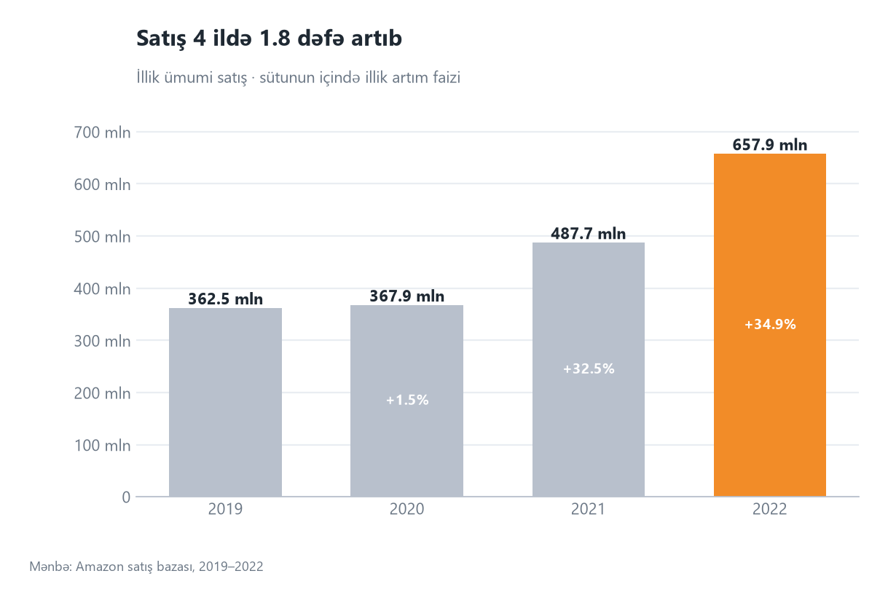
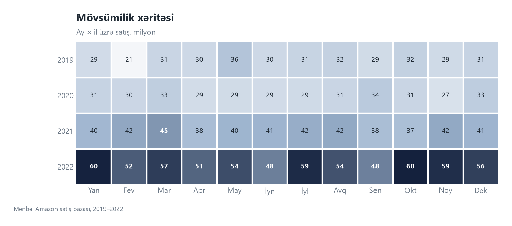
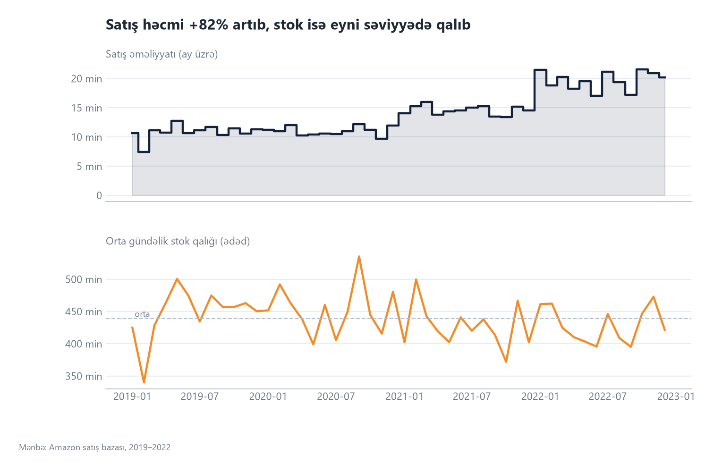

# Amazon satış analizi (2019–2022)

Amazon geyim satışlarının **Python + Power BI** ilə tam analizi: dağınıq Excel fayllarının təmizlənməsi (ETL), əsas göstəricilərin hesablanması və interaktiv Power BI hesabatı.


## Məqsəd

- 4 il ərzində satışın necə dəyişdiyini, artımın mənbəyini müəyyən etmək
- Ən gəlirli kateqoriyaları və regionları tapmaq
- Mövsümiliyi və stok səviyyəsini izləmək
- Rəhbərlik üçün interaktiv dashboard hazırlamaq

## Əsas nəticələr

| Göstərici | Dəyər |
|---|---:|
| Ümumi satış (2019–2022) | **1.88 mlrd** |
| Satış əməliyyatı | **672 709** |
| Orta illik artım (CAGR) | **22.0%** |
| Ən güclü ay | **Oktyabr 2022** (60.4 mln) |

| İl | Satış | İllik artım | Əməliyyat |
|---|---:|---:|---:|
| 2019 | 362.5 mln | — | 129 956 |
| 2020 | 367.9 mln | +1.5% | 131 915 |
| 2021 | 487.7 mln | +32.5% | 174 918 |
| 2022 | 657.9 mln | +34.9% | 235 920 |

**Müşahidələr**

1. **Artım həcm hesabınadır.** Orta əməliyyat dəyəri 4 il ərzində ~2 789 səviyyəsində sabit qalıb, satışın artımı isə tamamilə əməliyyat sayının artmasından gəlir (130 min → 236 min).
2. **2020 durğunluq ili olub** (+1.5%), 2021–2022-də isə satış hər il təxminən üçdə bir artıb.
3. **KURTA** kateqoriyası satışın **40%**-ni təşkil edir; KURTA, KURTA SET və SET birlikdə ~69%-dir — gəlir bir neçə kateqoriyada cəmlənib.
4. **Coğrafiya:** Texas, Pennsylvania, California və Illinois ən böyük bazarlardır.
5. **Satış tipi:** A tipinin satışdakı payı 2019-da 60% idi, 2020-dən bəri 52%-də sabitdir; B tipi 34%-dən 39%-ə qalxıb.
6. **Stok:** 2022-də aylıq satış əməliyyatı 2019-dakından orta hesabla ~82% çoxdur, orta gündəlik stok isə eyni səviyyədə qalıb — stok dövriyyəsi sürətlənib.

<p>
  
  
</p>




<p>
  
  
</p>



Tam hesabat: [reports/summary.md](reports/summary.md)

## Power BI hesabatı


İki səhifə: **📊 Satış icmalı** (KPI-lar, aylıq müqayisə, Top 10 şəhər, ştat matrisi) və **🗺️ Coğrafiya** (ştatlar üzrə xəritə). Səhifələr arasında yuxarıdakı düymələrlə keçid olunur.

Model ulduz sxemindədir: `amazon_sales` və `amazon_stock` fakt cədvəlləri, `Amazon_sku`, `Amazon_city` və `Calendar` ölçü cədvəlləri. Time-intelligence ölçüləri (YoY, MoM, YTD) DAX ilə yazılıb.
Quraşdırma, model sxemi və bütün DAX ölçüləri: [powerbi/README.md](powerbi/README.md)

## Layihənin strukturu

```
amazon-sales-analysis/
├── data/
│   ├── raw/              ← mənbə Excel faylları (repo-ya daxil deyil)
│   └── processed/        ← ETL-in yaratdığı təmiz CSV-lər (repo-ya daxil deyil)
├── src/
│   ├── etl.py            ← Excel → təmiz CSV
│   ├── analysis.py       ← göstəricilər, qrafiklər, summary.md
│   └── style.py          ← qrafiklərin vahid üslubu və rəng palitrası
├── reports/
│   ├── figures/          ← PNG qrafiklər
│   └── summary.md        ← avtomatik yaranan xülasə
├── powerbi/              ← Power BI Project (.pbip, TMDL + PBIR) və tema faylı
├── requirements.txt
└── README.md
```

## Məlumat

| Fayl | Məzmun | Sətir |
|---|---|---:|
| `Amazon Database sales.xlsx` | Tarix, şəhər, sifariş ID, satış məbləği, tip (A/B/C), məhsul kodu — hər il ayrı vərəqdə | 672 709 |
| `Amazon Database stock.xlsx` | Gündəlik stok qalığı (məhsul kodu üzrə) — hər il ayrı vərəqdə | 281 952 |
| `Amazon Database SKU.xlsx` | Məhsul kodu → dizayn, kateqoriya, ölçü, rəng | 9 169 |
| `Amazon Database City.xlsx` | ABŞ şəhərləri, ştatlar, koordinatlar | 30 409 |

Fayllar böyük olduğu üçün repo-ya daxil edilməyib. Onları `data/raw/` qovluğuna qoyun.

### Təmizləmə addımları (`src/etl.py`)

- Başlıq sətrindən əvvəlki lazımsız sətirlər avtomatik tapılıb silinir (sales: 4 sətir, city: 2 sətir, SKU: təkrarlanan başlıq).
- Hər ilin vərəqi bir cədvəldə birləşdirilir.
- Excel seriya nömrələri (`43466`) tarixə çevrilir.
- Təkrarlanan SKU və şəhər qeydləri silinir, kateqoriya adları standartlaşdırılır.
- Əlaqə yoxlaması: hər satışın şəhəri və məhsulu ölçü cədvəllərində tapılır (0% itki).

### Məlumatla bağlı qeydlər

- `Sifaris_İD` unikal deyil — eyni 34 745 ID hər il təkrarlanır. Ona görə analizdə hər sətir ayrı satış əməliyyatı sayılır.
- Stok gündəlik snapshot-dır, tarixlər üzrə cəmlənməməlidir — orta gündəlik və ya son tarix dəyəri istifadə olunur.

## İşə salmaq

```bash
git clone https://github.com/alyazcbbrv-byte/amazon-sales-analysis.git
cd amazon-sales-analysis
python -m venv .venv
.venv\Scripts\activate          # macOS/Linux: source .venv/bin/activate
pip install -r requirements.txt

# Excel fayllarını data/raw/ qovluğuna qoyun, sonra:
python src/etl.py
python src/analysis.py
```

ETL ~3 dəqiqə çəkir (sales faylı ~32 MB-dır). Sonra `powerbi/Amazon_Dashboard.pbip` faylını açıb `FolderPath` parametrini `data/processed\` qovluğuna yönləndirin.

## Texnologiyalar

- **Python**: pandas, openpyxl, matplotlib
- **Power BI Desktop**: Power Query (M), DAX, PBIP/TMDL formatı
- **Git** ilə versiya nəzarəti — Power BI modeli mətn faylları kimi saxlanılır
