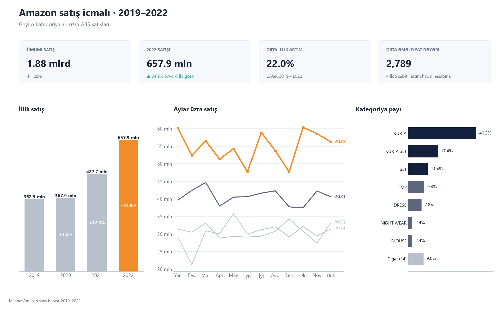
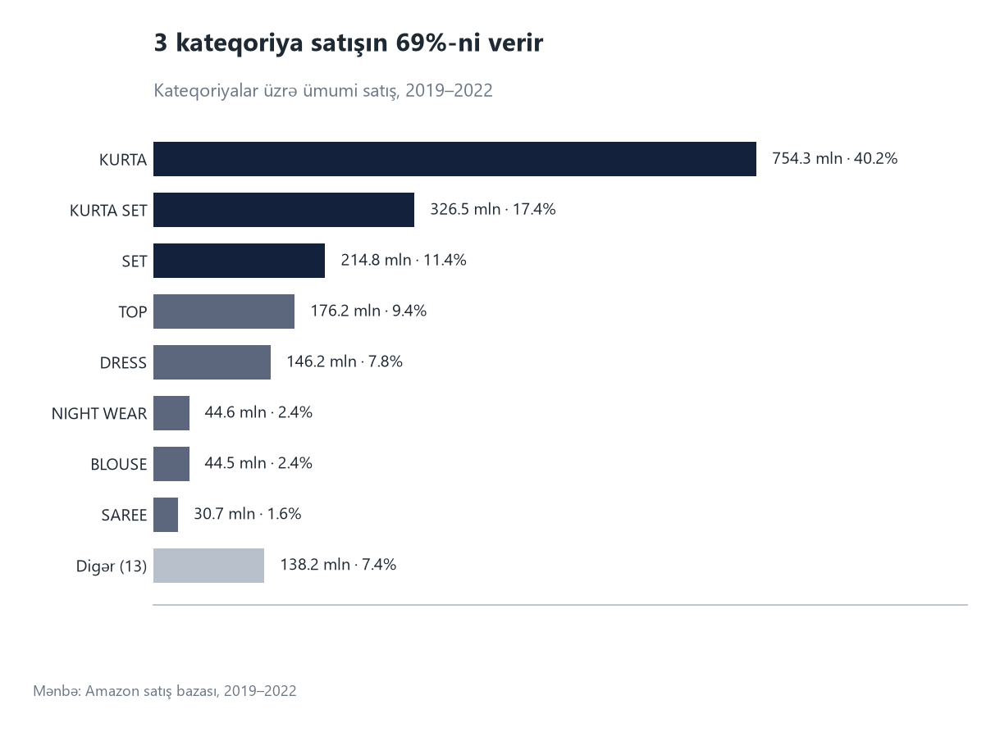
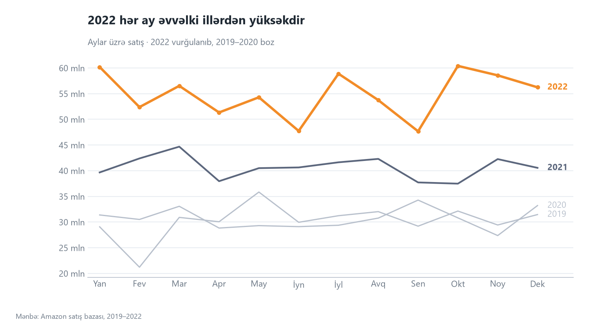
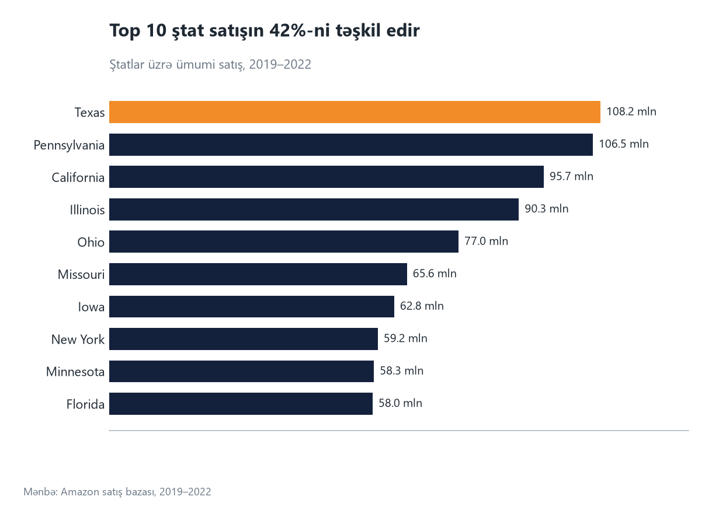
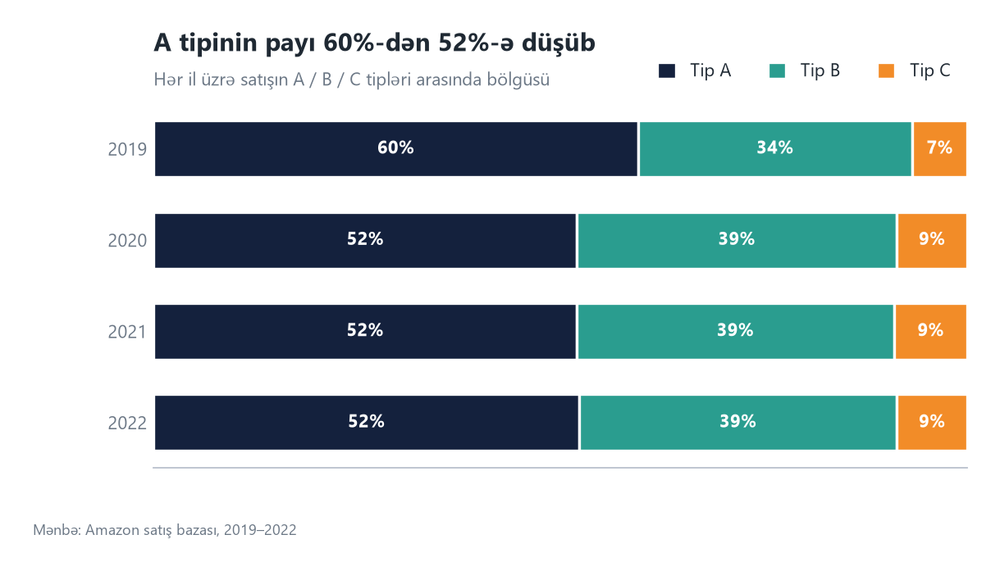
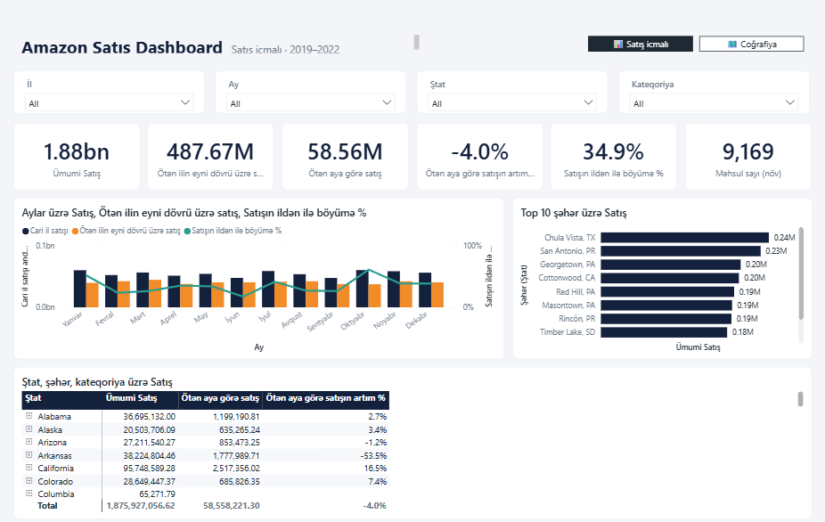

# Amazon Sales Analysis (2019–2022)

🇬🇧 English · [🇦🇿 Azərbaycanca](README.az.md)

End-to-end analysis of Amazon apparel sales with **Python and Power BI**: cleaning messy Excel files (ETL), computing the key metrics, and an interactive Power BI report.




## Business questions

- How did sales change over four years, and where did the growth come from?
- Which categories and regions earn the most?
- Is there seasonality, and how does inventory move relative to sales?
- Can the answers be packaged as an interactive dashboard for management?

## Key results

| Metric | Value |
|---|---:|
| Total sales (2019–2022) | **1.88 bn** |
| Sales transactions | **672,709** |
| Compound annual growth (CAGR) | **22.0%** |
| Strongest month | **October 2022** (60.4 M) |

| Year | Sales | YoY growth | Transactions |
|---|---:|---:|---:|
| 2019 | 362.5 M | n/a | 129,956 |
| 2020 | 367.9 M | +1.5% | 131,915 |
| 2021 | 487.7 M | +32.5% | 174,918 |
| 2022 | 657.9 M | +34.9% | 235,920 |

### Insights

1. **Growth is volume-driven.** The average transaction value stayed at about 2,789 for four years, so all growth comes from more transactions (130 k → 236 k).
2. **2020 was flat** (+1.5%); in 2021 and 2022 sales grew by roughly a third each year.
3. **KURTA accounts for 40% of sales**, and KURTA, KURTA SET and SET together make up about 69%: revenue is concentrated in a few categories.
4. **Geography:** Texas, Pennsylvania, California and Illinois are the biggest markets.
5. **Sales type:** type A fell from 60% of sales in 2019 to 52% from 2020 on; type B rose from 34% to 39%.
6. **Inventory:** monthly sales transactions in 2022 are on average ~82% higher than in 2019, while the average daily stock stayed flat, so inventory turns faster.

<p>
  
  
</p>




<p>
  
  
</p>


Full generated report: [reports/summary.md](reports/summary.md)

## Power BI report



Two pages with navigation buttons: **Sales overview** (KPIs, monthly comparison, Top 10 cities, state matrix) and **Geography** (sales by state map).

The model is a star schema: fact tables `amazon_sales` and `amazon_stock`, dimensions `Amazon_sku`, `Amazon_city` and `Calendar`. Time-intelligence measures (YoY, MoM, YTD) are written in DAX. Setup, model and all measures: [powerbi/README.md](powerbi/README.md)

## Project structure

```
amazon-sales-analysis/
├── data/
│   ├── raw/              ← source Excel files (not in the repo)
│   └── processed/        ← clean CSVs produced by the ETL (not in the repo)
├── src/
│   ├── etl.py            ← Excel → clean CSV
│   ├── analysis.py       ← metrics, charts, summary.md
│   └── style.py          ← shared chart style and colour palette
├── reports/
│   ├── figures/          ← PNG charts
│   └── summary.md        ← auto-generated summary
├── powerbi/              ← Power BI Project (.pbip, TMDL + PBIR) and theme
├── requirements.txt
└── README.md
```

## Data

| File | Content | Rows |
|---|---|---:|
| `Amazon Database sales.xlsx` | Date, city, order ID, sales amount, type (A/B/C), product code; one sheet per year | 672,709 |
| `Amazon Database stock.xlsx` | Daily stock level per product code; one sheet per year | 281,952 |
| `Amazon Database SKU.xlsx` | Product code → design, category, size, colour | 9,169 |
| `Amazon Database City.xlsx` | US cities, states, coordinates | 30,409 |

The files are large, so they are not included. Put them into `data/raw/`. They are educational sample data from a training course.

### Cleaning steps (`src/etl.py`)

- Junk rows above the header are detected and removed automatically (sales: 4 rows, city: 2 rows, SKU: repeated header).
- The yearly sheets are combined into a single table.
- Excel serial numbers (`43466`) are converted to dates.
- Duplicate SKU and city records are dropped and category names are standardised.
- Referential check: every sale finds its city and product in the dimension tables (0% loss).

### Data notes

- `Sifaris_İD` (order ID) is not unique: the same 34,745 IDs repeat every year. Each row is therefore treated as a separate sales transaction.
- Stock is a daily snapshot and must not be summed over dates; the average daily or last-date value is used instead.

## How to run

```bash
git clone https://github.com/alyazcbbrv-byte/amazon-sales-analysis.git
cd amazon-sales-analysis
python -m venv .venv
.venv\Scripts\activate          # macOS/Linux: source .venv/bin/activate
pip install -r requirements.txt

# put the Excel files into data/raw/, then:
python src/etl.py
python src/analysis.py
```

The ETL takes about 3 minutes (the sales file is ~32 MB). Then open `powerbi/Amazon_Dashboard.pbip` and point the `FolderPath` parameter at `data/processed\`.

## Skills demonstrated

- **Data cleaning and ETL** with pandas, including automated data-quality checks
- **Exploratory and business analysis**: growth decomposition, concentration, seasonality, inventory turnover
- **Data modelling**: star schema with fact and dimension tables
- **DAX**: time-intelligence measures (YoY, MoM, YTD)
- **Data visualisation** in matplotlib and Power BI
- **Version control** of a Power BI model (PBIP / TMDL)

## Author

**Alyaz Cabbarova**: [GitHub](https://github.com/alyazcbbrv-byte)

More projects: [Toyota sales dashboard](https://github.com/alyazcbbrv-byte/toyota-sales-powerbi) · [Retail chain: sales vs plan and churn](https://github.com/alyazcbbrv-byte/retail-sales-vs-plan-powerbi)

## License

[MIT](LICENSE) for the code and report. The source data is educational sample data from a training course and is not redistributed here.
