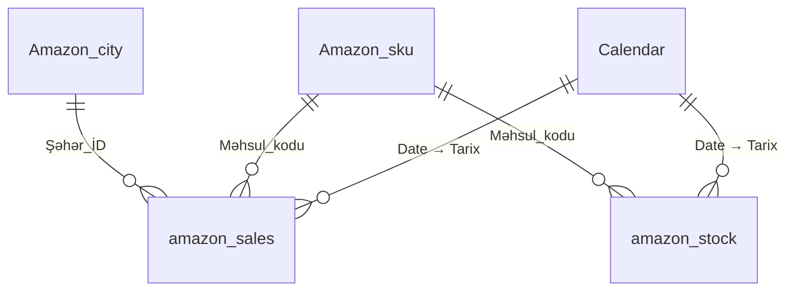

# Power BI hesabatı

Hesabat **Power BI Project (`.pbip`)** formatında saxlanılıb: model TMDL, hesabat isə PBIR formatında mətn fayllarıdır. Bu, dəyişiklikləri Git-də sətir-sətir izləməyə imkan verir.

```
powerbi/
├── Amazon_Dashboard.pbip          ← bu faylı açın
├── Amazon.Report/                 ← səhifələr və vizuallar (PBIR)
└── Amazon.SemanticModel/          ← cədvəllər, əlaqələr, DAX ölçüləri (TMDL)
```

## Açmaq üçün

1. **Power BI Desktop** → File → Options and settings → Options → **Preview features**:
   - *Power BI Project (.pbip) save option*
   - *Store reports using enhanced metadata format (PBIR)*
   - *Store semantic model using TMDL format*

   İşarələyin və Desktop-u yenidən başladın.
2. Əvvəlcə Python ETL-i işə salın ki, `data/processed/` qovluğunda 4 CSV fayl yaransın (əsas README-yə baxın).
3. `Amazon_Dashboard.pbip` faylını açın.
4. **Home → Transform data → Edit parameters → `FolderPath`**: `data/processed` qovluğunun tam yolunu yazın, sonunda `\` olsun.
   Məsələn: `C:\Users\Ad\Documents\amazon-sales-analysis\data\processed\`
5. **Apply changes → Refresh**.
6. Tema (`theme/amazon_theme.json`) hesabata artıq daxil edilib, əlavə addım lazım deyil.

## Vizual tema

`theme/amazon_theme.json` Python qrafikləri ilə eyni palitranı istifadə edir, ona görə README-dəki şəkillər və Power BI hesabatı eyni üslubda görünür:

| Rəng | Hex | İstifadə |
|---|---|---|
| Tünd göy | `#14213D` | əsas seriya, KPI rəqəmləri, cədvəl başlıqları |
| Narıncı | `#F28C28` | vurğu: cari il, ən yaxşı dəyər |
| Firuzəyi | `#2A9D8F` | müsbət dəyişmə |
| Qırmızı | `#D1495B` | mənfi dəyişmə |
| Boz | `#B8C0CC` | fon elementləri, müqayisə seriyaları |

Tema bütün vizuallara ağ fon, nazik kənar xətti və 8 px yuvarlaq künclər verir; səhifə fonu açıq bozdur (`#F3F5F8`), xəritə isə açıq bozdan tünd göyə qradiyentlə rənglənir.

**Peşəkar görünüş üçün tövsiyələr**
- KPI kartlarını yuxarıda bir sırada, eyni ölçüdə yerləşdirin; slicer-ləri sol paneldə toplayın.
- Artım faizləri üçün (illik / aylıq %) Conditional formatting → Font color → Rules: `< 0` qırmızı `#D1495B`, `>= 0` firuzəyi `#2A9D8F`.
- Combo chart-da *Ötən il* seriyasını boz `#B8C0CC`, cari ili tünd göy edin — müqayisə daha aydın görünür.

## Model

Ulduz sxemi (star schema): bir fakt cədvəli və onun ətrafında ölçü cədvəlləri.



| Cədvəl | Növ | Təsvir |
|---|---|---|
| `amazon_sales` | Fakt | Gündəlik satış əməliyyatları (2019–2022), ~673 min sətir |
| `amazon_stock` | Fakt | Gündəlik stok snapshot-ları, ~282 min sətir |
| `Amazon_sku` | Ölçü | Məhsul kodu, dizayn, kateqoriya, ölçü, rəng |
| `Amazon_city` | Ölçü | ABŞ şəhərləri, ştatlar və koordinatlar (xəritə üçün) |
| `Calendar` | Ölçü | `CALENDAR(2019-01-01, 2022-12-31)` — İl, Ay, İlAy sütunları |

## DAX ölçüləri

| Ölçü | Düstur |
|---|---|
| Ümumi Satış | `SUM(amazon_sales[Satış])` |
| Ötən ilin eyni dövrü üzrə satış | `CALCULATE([Ümumi Satış], SAMEPERIODLASTYEAR('Calendar'[Date]))` |
| Satışın ildən ilə böyümə % | `DIVIDE([Ümumi Satış] - [Ötən ilin eyni dövrü üzrə satış], [Ötən ilin eyni dövrü üzrə satış])` |
| Ötən aya görə satış | `IF(HASONEVALUE('Calendar'[İlAy]), CALCULATE([Ümumi Satış], DATEADD('Calendar'[Date], -1, MONTH)))` |
| Ötən aya görə satışın artım % | `DIVIDE([Ümumi Satış] - [Ötən aya görə satış], [Ötən aya görə satış])` |
| İlin əvvəlindən satış (YTD) | `TOTALYTD([Ümumi Satış], 'Calendar'[Date])` |
| Satış payı % | `DIVIDE([Ümumi Satış], CALCULATE([Ümumi Satış], ALLSELECTED()))` |
| Əməliyyat sayı | `COUNTROWS(amazon_sales)` |
| Orta əməliyyat dəyəri | `DIVIDE([Ümumi Satış], [Əməliyyat sayı])` |
| Məhsul sayı (növ) | `DISTINCTCOUNT(amazon_sales[Məhsul_kodu])` |
| Orta gündəlik stok | `AVERAGEX(VALUES('Calendar'[Date]), CALCULATE(SUM(amazon_stock[Stock])))` |
| Son tarixdəki stok | seçilmiş dövrün son stok tarixindəki cəm |

> Stok snapshot olduğu üçün `SUM(Stock)` tarixlər üzrə cəmlənməməlidir — ona görə orta gündəlik və son tarix ölçüləri istifadə olunur.

## Hesabat səhifələri

1. **Satış icmalı**
   - KPI kartları: Ümumi Satış, Ötən ilin eyni dövrü, İldən ilə böyümə %, Ötən aya görə satış, Aylıq artım %, Məhsul sayı
   - Top 10 şəhər (bar chart, Top N filtri hazırdır)
   - Aylar üzrə satış, ötən il və illik artım % (combo chart)
   - Ştat → Şəhər → Kateqoriya üzrə matris (satış, ötən ay, aylıq artım %)
   - Slicer-lər: İl, Ay, Kateqoriya, Ştat
2. **Coğrafiya** — ştatlar üzrə satış (filled map) və eyni 4 slicer.

### Əl ilə tamamlanmalı addımlar
- Aylar qrafiki: Format → Edit interactions ilə Ay slicer-inin təsirini söndürün.
- Calendar cədvəli: Table tools → **Mark as date table** → `Date` (işarələnməyibsə).
- Hesabatın ekran şəklini `reports/figures/powerbi_dashboard.png` kimi saxlayın — əsas README-də göstəriləcək.
