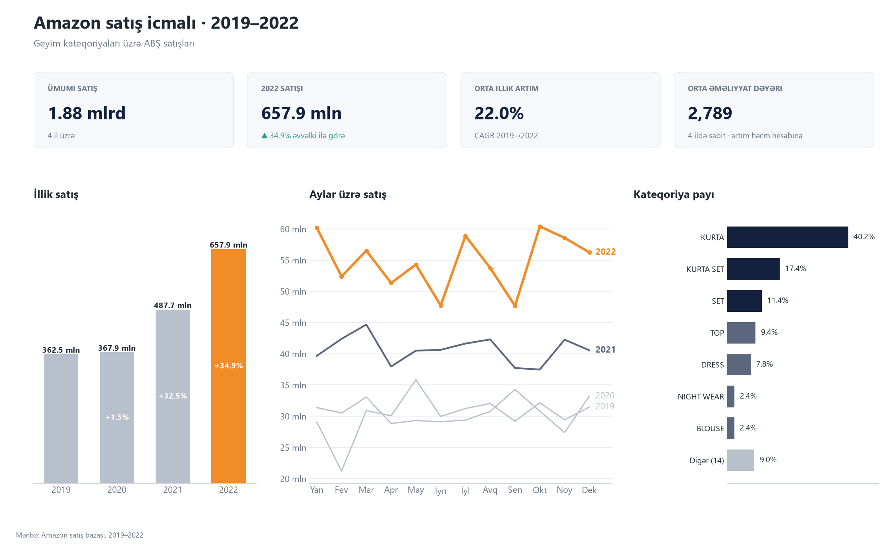
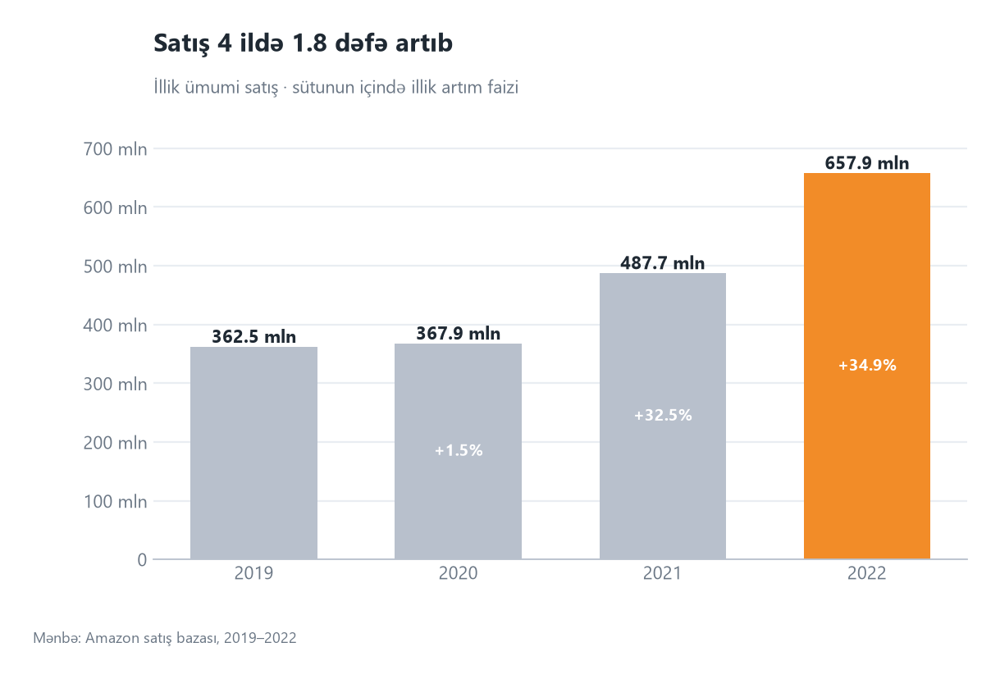
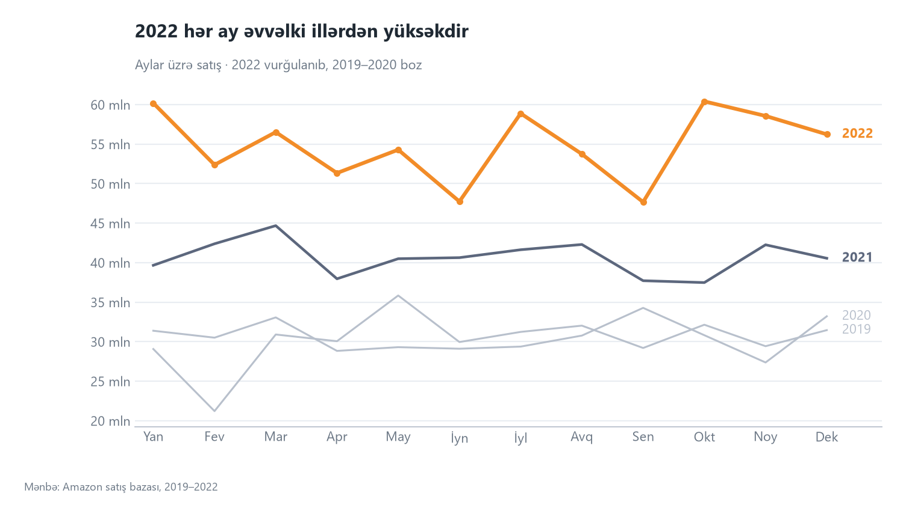
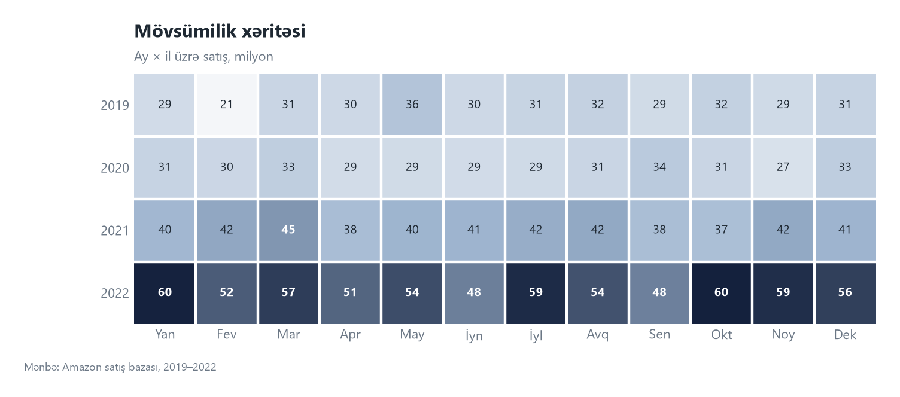
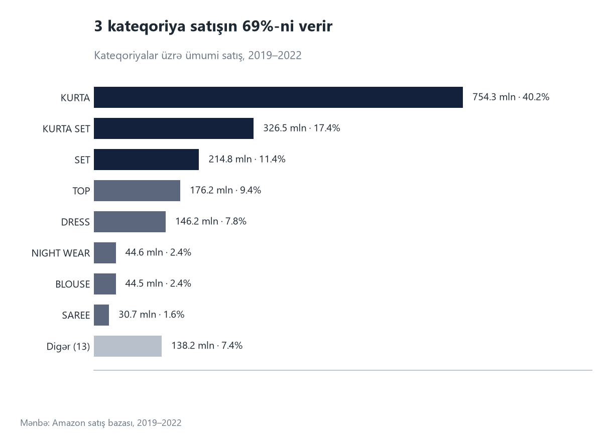
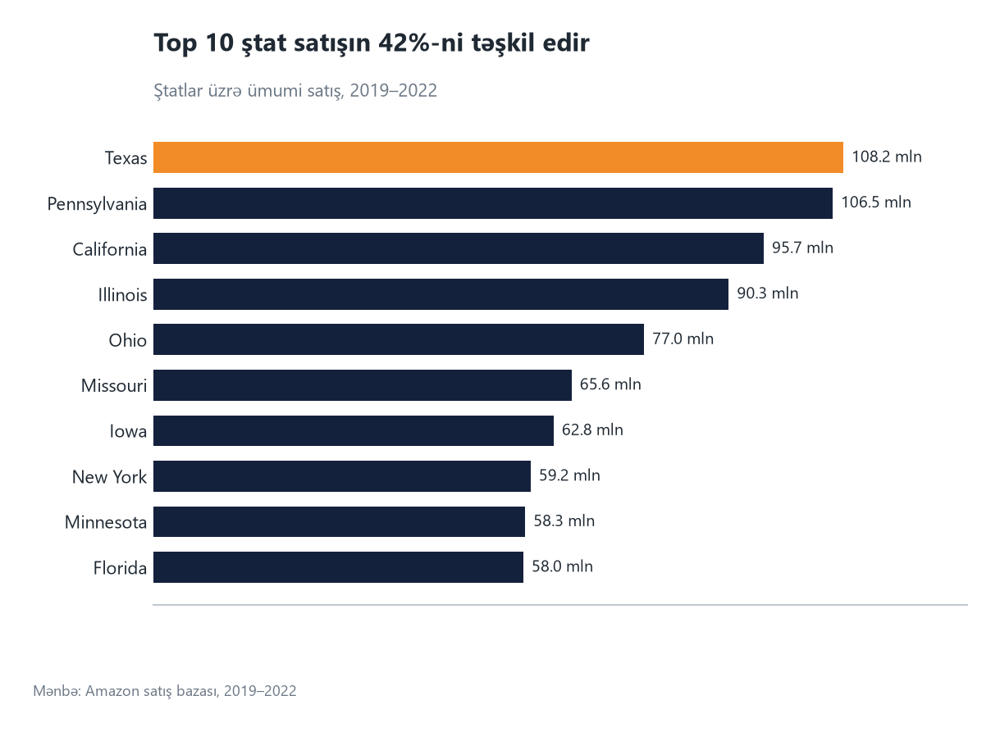
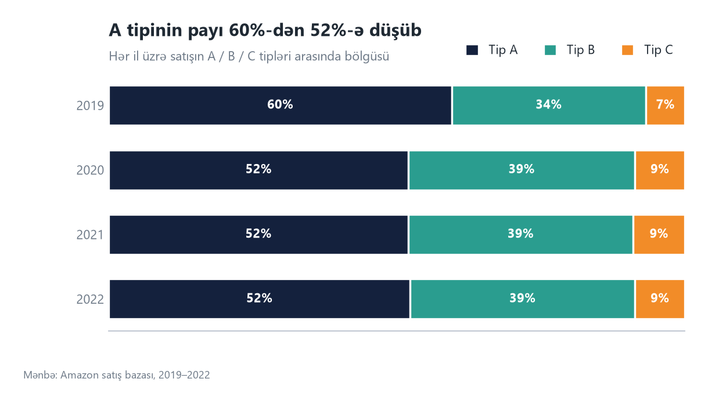
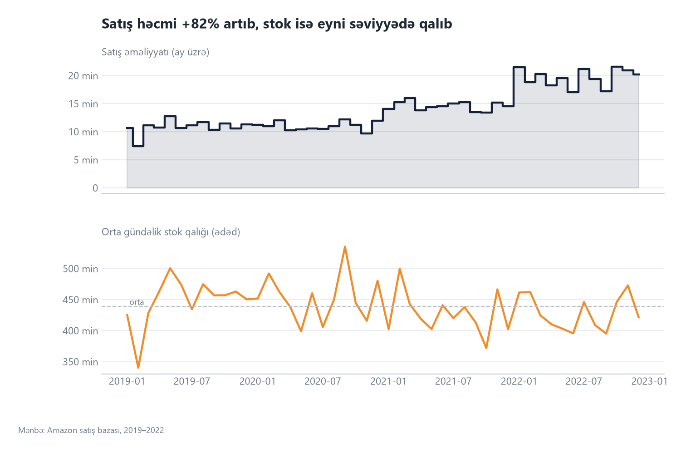

# Amazon satış analizi — xülasə

_Bu fayl `python src/analysis.py` ilə avtomatik yaradılır._

## Əsas göstəricilər

- Ümumi satış (2019–2022): **1,875,927,057**
- Satış əməliyyatı: **672,709**, orta əməliyyat dəyəri: **2,789**
- Orta illik artım (CAGR): **22.0%**
- Ən güclü ay: **Oktyabr 2022** (60,399,896)
- 4 ilin cəmində ən yüksək satış **Mart**, ən aşağı **Fevral** ayındadır

## İllər üzrə

| İl | Satış | İllik artım | Əməliyyat | Orta əməliyyat dəyəri | Məhsul (SKU) |
|---|---:|---:|---:|---:|---:|
| 2019 | 362,454,957 | — | 129,956 | 2,789 | 2,348 |
| 2020 | 367,937,639 | +1.5% | 131,915 | 2,789 | 2,375 |
| 2021 | 487,668,004 | +32.5% | 174,918 | 2,788 | 2,218 |
| 2022 | 657,866,457 | +34.9% | 235,920 | 2,789 | 2,228 |

## Kateqoriyalar

| Kateqoriya | Satışdakı payı |
|---|---:|
| KURTA | 40.2% |
| KURTA SET | 17.4% |
| SET | 11.4% |
| TOP | 9.4% |
| DRESS | 7.8% |
| NIGHT WEAR | 2.4% |
| BLOUSE | 2.4% |
| SAREE | 1.6% |
| TUNIC | 1.6% |
| AN : LEGGINGS | 1.4% |
| PALAZZO | 1.0% |
| PANT | 1.0% |
| SHARARA | 0.5% |
| CROP TOP | 0.4% |
| LEHENGA CHOLI | 0.4% |
| KURTI | 0.3% |
| SKIRT | 0.2% |
| BOTTOM | 0.2% |
| CARDIGAN | 0.2% |
| JUMPSUIT | 0.1% |
| CROP TOP WITH PLAZZO | 0.1% |

## Coğrafiya — top 10 ştat

| Ştat | Satış |
|---|---:|
| Texas | 108,216,598 |
| Pennsylvania | 106,540,169 |
| California | 95,748,589 |
| Illinois | 90,266,927 |
| Ohio | 76,972,647 |
| Missouri | 65,588,690 |
| Iowa | 62,768,523 |
| New York | 59,157,731 |
| Minnesota | 58,310,744 |
| Florida | 58,022,698 |

## Satış tipi (A / B / C)

| İl | Tip A | Tip B | Tip C |
|---|---:|---:|---:|
| 2019 | 59.5% | 33.7% | 6.8% |
| 2020 | 52.0% | 39.3% | 8.7% |
| 2021 | 52.0% | 39.0% | 9.0% |
| 2022 | 52.3% | 39.0% | 8.7% |

## Stok

Stok cədvəli gündəlik snapshot-dır, ona görə dəyərlər tarixlər üzrə cəmlənmir — günlük cəmin ortası götürülür.

| Kateqoriya | Orta gündəlik stok | Stokda izlənən SKU |
|---|---:|---:|
| KURTA | 176,794 | 3,700 |
| KURTA SET | 76,377 | 1,596 |
| SET | 50,070 | 1,049 |
| TOP | 41,224 | 861 |
| DRESS | 33,613 | 700 |
| BLOUSE | 10,757 | 219 |
| NIGHT WEAR | 10,498 | 217 |
| TUNIC | 7,867 | 154 |
| SAREE | 7,453 | 147 |
| AN : LEGGINGS | 6,935 | 130 |

