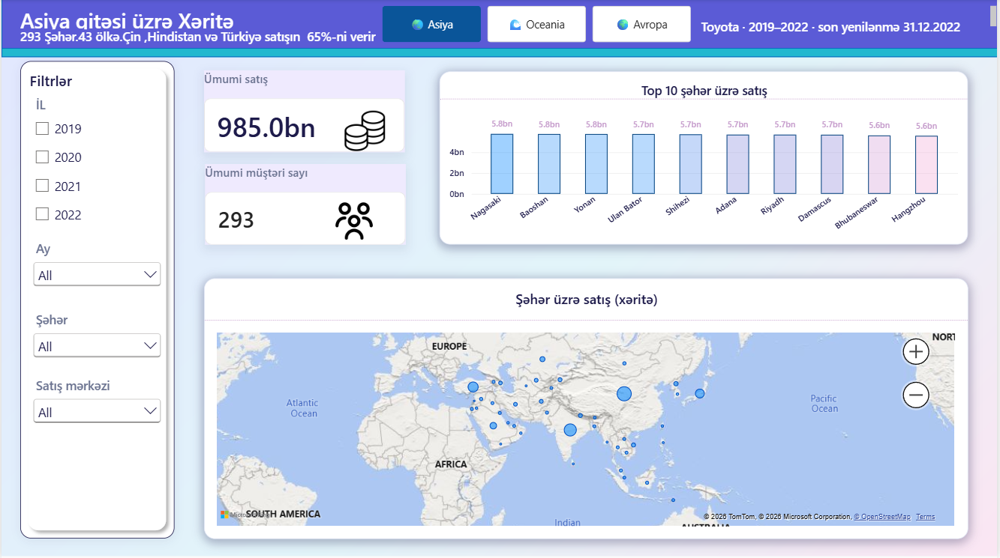
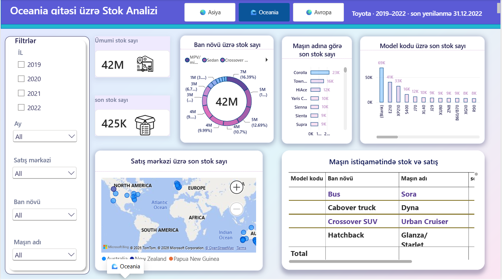
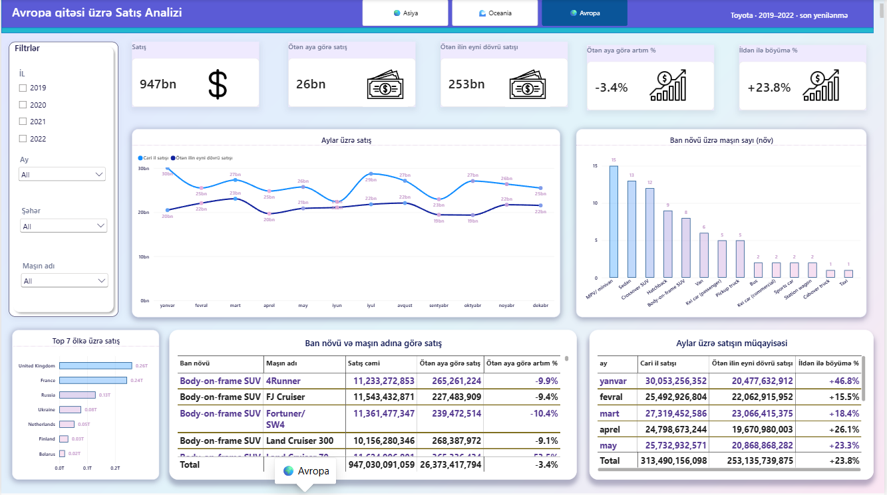

# Toyota satış dashboard-u (Power BI)

İmtahan layihəsi əsasında hazırlanmış 3 səhifəli Power BI hesabatı: qitələr üzrə satış və stok analizi (2019–2022).

**Fayl:** [Toyota_Dashboard.pbix](Toyota_Dashboard.pbix) (Power BI Desktop ilə açın)

## Səhifələr

Hər səhifənin yuxarısında ikonlu naviqator düymələri var (🌏 Asiya · 🌊 Oceania · 🌍 Avropa).

### 🌏 Asiya: satış xəritəsi

### 🌊 Oceania: stok analizi

### 🌍 Avropa: satış analizi

## Data modeli

| Cədvəl | Təsvir |
|---|---|
| `Append` | Satış əməliyyatları (tarix, şəhər, satış, tip, maşın kodu) |
| `Append (2)` | Gündəlik stok qalığı |
| `Toyota_sku` | Maşın məlumatı (ad, ban növü, model, satış mərkəzi) |
| `Toyota_city` | Şəhər, ölkə, qitə, koordinatlar |
| `Calendar` | Tarix cədvəli (il, ay, ay nömrəsi) |

## DAX ölçüləri

Ölçülər Data panelində qovluqlara bölünüb.

### Ümumi DAX
| Ölçü | Düstur |
|---|---|
| Satış cəmi | `SUM ( 'Append'[Satış] )` |
| Ümumi müştəri sayı | `DISTINCTCOUNT ( 'Append'[Şəhər_İD] )` |
| Maşın sayı (növ) | `DISTINCTCOUNT ( 'Append'[Maşın kodu] )` |

### Okeaniya DAX (stok)
| Ölçü | Düstur |
|---|---|
| Total Stok sayı | `SUM ( 'Append (2)'[Stock] )` |
| son stok sayı | `SUMX ( VALUES ( 'Toyota_sku'[Maşın kodu] ), CALCULATE ( SUM ( 'Append (2)'[Stock] ), LASTNONBLANK ( 'Calendar'[Date], CALCULATE ( SUM ( 'Append (2)'[Stock] ) ) ) ) )` |

### Avropa DAX (müqayisə)
Seçimdəki **son tarixə** görə hesablanır, ona görə filtr seçilməyəndə də düzgün işləyir.

| Ölçü | Təsvir |
|---|---|
| Cari il satışı | Seçimdəki son ilin satışı |
| Ötən ilin eyni dövrü satışı | `SAMEPERIODLASTYEAR` ilə bir il əvvəlki eyni dövr |
| İldən ilə böyümə % | `DIVIDE ( [Cari il satışı] - [Ötən ilin eyni dövrü satışı], [Ötən ilin eyni dövrü satışı] )` |
| Cari ay satışı | Seçimdəki son ayın satışı |
| Ötən aya görə satış | Son aydan bir əvvəlki ayın satışı |
| Ötən aya görə artım % | `DIVIDE ( [Cari ay satışı] - [Ötən aya görə satış], [Ötən aya görə satış] )` |

## Yoxlama zamanı tapılıb düzəldilənlər

| Problem | Düzəliş |
|---|---|
| `ay` sütunu əlifba sırası ilə düzülürdü (aprel, avqust, dekabr…) | `Ayno` ilə sıralama bağlandı |
| İl seçilməyəndə **İldən ilə böyümə** 54% göstərirdi (bütün illərin cəmi ilə müqayisə) | Son il ilə əvvəlki il müqayisə olunur: **34.8%** |
| `Ötən aya görə satış` ay seçilməyəndə məna vermirdi | Son ay ilə əvvəlki ay müqayisə olunur |
| `son stok sayı` yalnız son günün qeydlərini toplayırdı | Hər maşının öz son stoku götürülür |
| Satış kartı və cədvəllər ölçü əvəzinə birbaşa sütunu toplayırdı | `[Satış cəmi]` və `[Cari il satışı]` ölçüləri istifadə olunur |
| Avropa səhifəsində "Ümumi müştəri sayı" kartı satış göstəricisinin yerində idi | Kart "Satış" olaraq düzəldildi |
| Asiya səhifəsində iki eyni "Şəhər" filtri var idi | İkincisi **Satış mərkəzi** filtrinə çevrildi |
| Asiya şəhər qrafiki 293 şəhəri sıxışdırırdı | **Top 10** şəhərlə məhdudlaşdırıldı |
| Statik şəkil kimi görünən "düymələr" işləmirdi | Hazır səhifə naviqatoru ilə əvəz olundu |
| Başlıqlarda yazı səhvləri: «ölçə», «Xərita» | «ölkə», «Xəritə» |
